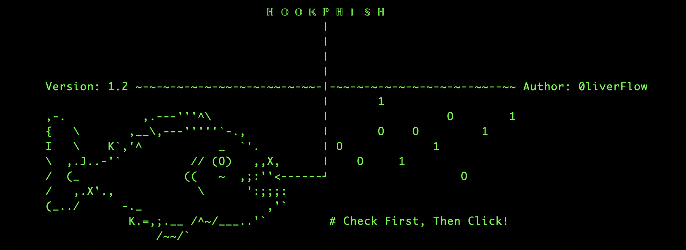
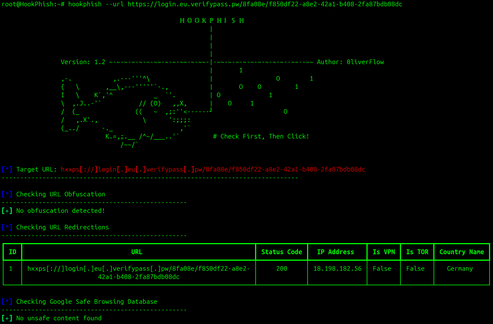
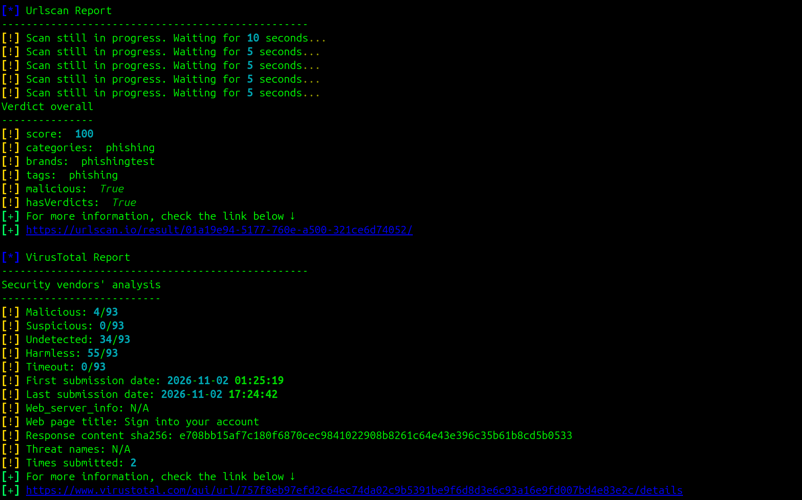
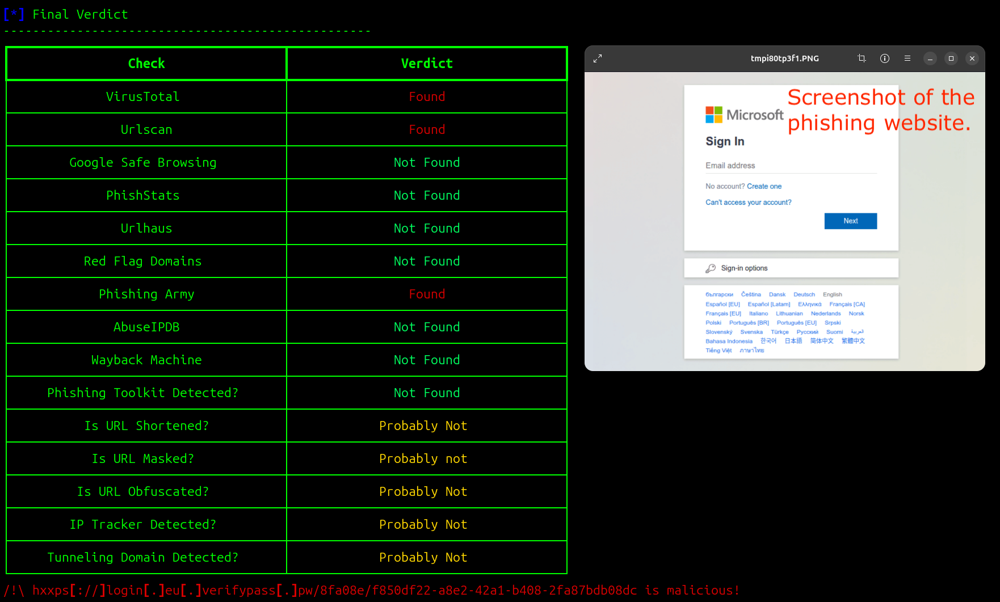
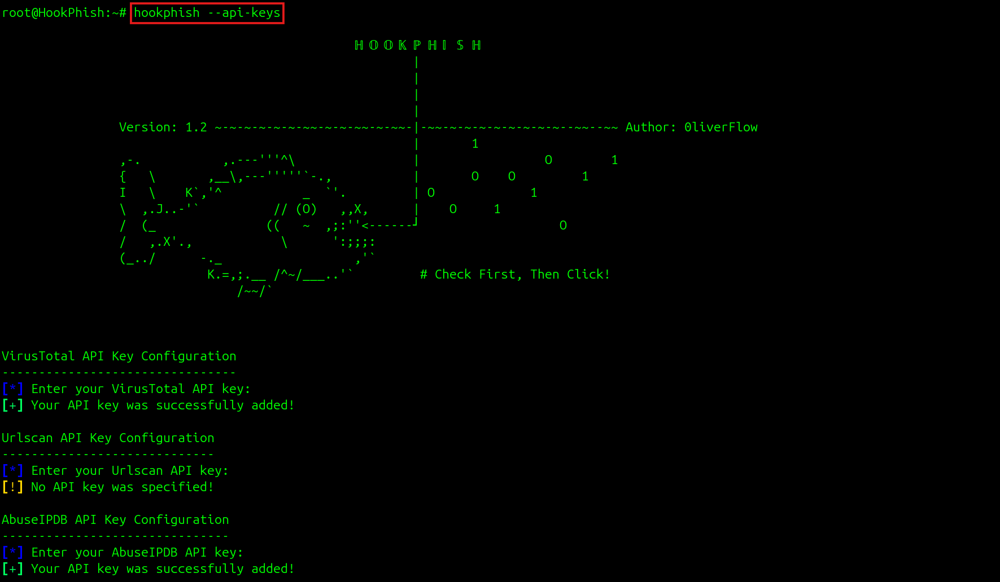

# HookPhish
[](https://www.python.org/) 
   

HookPhish is a Python script designed to aid in the detection of phishing websites using passive detection techniques.

# Features

HookPhish performs various checks on suspected URLs, including but not limited to:

- URL redirections
- URL masking
- DNS and IP Lookup
- Phishing toolkits detection
- Malicious GitHub pages detection
- PhishStats, Phishing Army, Red Flag Domains checks
- Google Safe Browsing check
- Real-time screenshot

Furthermore, it utilizes the APIs of [VirusTotal](https://docs.virustotal.com/reference/scan-url), [URLscan](https://docs.urlscan.io/apis/urlscan-openapi/scanning/submitscan), [URLHaus](https://urlhaus-api.abuse.ch/#urlinfo) and [AbuseIPDB](https://docs.abuseipdb.com/?python#check-endpoint) to extend its functionalities.

# Installation  

Before installing HookPhish, you will first need to install [Playwright](https://playwright.dev/python/docs/intro). This is an open-source package developed by Microsoft for browser testing and web scraping.  

This can be done with this command:

```python
pipx install playwright
```

After that, you can install Chromium, Firefox and WebKit browsers using this command:

```
playwright install
```

Note that, Playwright works on the following OS:
- Windows 11+, Windows Server 2019+ or Windows Subsystem for Linux (WSL).
- macOS 14 (Sonoma) or later.
- Debian 12 / 13, Ubuntu 22.04 / 24.04 / 26.04 (x86-64 or arm64).

Once Playwright installed, you can proceed with HookPhish installation using `pipx` or `uv`.

## Pipx

```
pipx install git+https://github.com/0liverFlow/HookPhish
```

## Uv

```
uv tool install git+https://github.com/0liverFlow/HookPhish
```

```
uvx git+https://github.com/0liverFlow/HookPhish
```

# Usage

```
usage: HookPhish.py [-h] [-u URL] [--api-keys] [--no-banner] [-v]

A Python script that helps detecting phishing websites using passive detection techniques.

options:
  -h, --help         show this help message and exit
  -u URL, --url URL  Suspicious URL to check
  --api-keys         Configure VirusTotal, Urlscan, URLhaus, and AbuseIPDB API keys (Recommended)
  --no-banner        Remove banner
  -v, --verbose      Verbosity
```

## URL Scanning

```python
hookphish --url <suspicious_url>
```







## API Keys Configuration

Though you can run the tool without specifying any API keys, it is recommended to use them in order to obtain more detailed information about the suspicious URL.  
To do that, you can simply generate a temporary email using [Tempmail](https://temp-mail.org/), then authenticate to each of the services (VirusTotal, Urlscan, AbuseIPDB, URLhaus) and create your API key.  
Once the API keys created, you can add them to HookPhish using the `--api-keys` flag:

```python
hookphish --api-keys
```



### Rate Limit

Here are the rate limits of the APIs used by HookPhish.
<table>
  <tr>
    <td> API </td>
    <td> Rate Limits</td>
  </tr>
  <tr>
    <td> Virustotal </td>
    <td> The public API is limited to 500 requests per day and a rate of 4 requests per minute </td>
  </tr>
  <tr>
    <td> Urlscan.io </td>
    <td> Unlisted scans are limited to 1000	requests per day and 60 requests per minute </td>
  </tr>
  <tr>
    <td> AbuseIPDB </td>
    <td> All free accounts have a rate limit of 1000 reports and checks per day </td>
  </tr>
    <tr>
    <td> URLhaus </td>
    <td> N/A </td>
  </tr>
</table>

# Changelog

## Version 1.1

- Added VirusTotal check.
- Added a Dockerfile to simplify deployment.
- Updated the documentation.

## Version 1.2

- Added a pyproject.toml to ease the tool installation using pipx and uv.
- Added phishing toolkits detection.
- Added malicious GitHub pages detection.
- Added URL obfuscation detection.
- Added PhishStats, Phishing Army, Red Flag Domains and URLhaus checks.
- Added multithreading to speed up the scanning process.
- Added URL unfurl.
- Added Wayback Machine check.
- Added TLS certificate information.
- Replaced config.ini with a .env file for API keys configuration.
- Linted the code with ruff.
- Removed Whois feature.
- Removed the Dockerfile.
- Updated the documentation.

# Contribution

1. If you noticed any bugs, thanks to report [here](https://github.com/0liverFlow/HookPhish/issues).
2. Pull requests are welcome. Feel free to open an [issue](https://github.com/0liverFlow/HookPhish/issues/new) if you want to improve or add new features.
